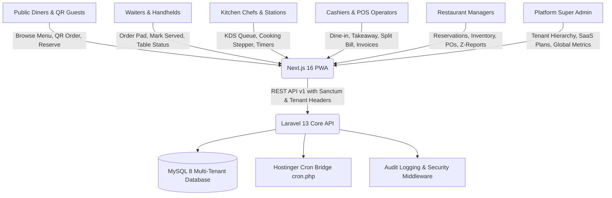

# RESTAURANT OS - PROJECT PROGRESS & ARCHITECTURE AUDIT

**Project Type:** Full-stack, Multi-tenant Restaurant Management System (Restaurant OS)  
**Current Phase:** All 8 Phases 100% Completed, Verified & Production-Ready  
**Frontend Deployment Target:** Vercel / Hostinger (Next.js 16 App Router, TypeScript, Tailwind CSS v4, Recharts, Serwist PWA, qrcode.react)  
**Backend Deployment Target:** Hostinger Unlimited Shared Hosting / Railway (Laravel 13 REST API, PHP 8.3+, Sanctum, Spatie Permission, MySQL 8)  
**Architecture Model:** Zero-Daemon Architecture (No Redis, Supervisor, or permanent Node daemons required on shared hosting)  

---

## 1. Executive Summary of Phase 8 Deliverables

Phase 8 completes the Restaurant OS platform with Executive Business Analytics, Printable End-of-Day Z-Reports, GST Tax Compliance Ledgers, Multi-Restaurant SaaS Subscription Quotas, and Hostinger Unlimited deployment tooling.

### Completed Features:

- [x] **Executive Reports & Business Intelligence (`/reports`)**
  - **Revenue & Sales Trends Dashboard:** Multi-period date filter (today, last 7 days, last 30 days, custom range) with Recharts daily gross revenue, net food sales, tax liabilities, and average order value (AOV).
  - **Dining Channel Distribution:** Comparative analysis of Dine-in, Takeaway, and Direct Delivery volumes and revenues.
  - **Tender Reconciliations:** Audited payment modes breakdown across Cash in register, instant UPI / QR Pay, and POS Card swipes.
  - **24-Hour Dining Rush Distribution:** Peak operational volume heatmap highlighting lunch (1:00 PM – 3:00 PM) and dinner (8:00 PM – 10:00 PM) table rushes.

- [x] **Menu Engineering & Product Mix Matrix**
  - **Dish Performance Rankings:** Top dishes ranked by cumulative revenue and portion sales volume.
  - **Category Sales Contribution:** Dynamic percentage breakdown across Biryanis, Starters, Curries, Beverages, and Desserts.

- [x] **Dining Floor & Service Speed Analytics**
  - **Table Turnaround Speed:** Calculates real-time average dining duration from table seating to bill settlement.
  - **Live Floor Occupancy Rate:** Real-time occupancy percentage with section utilization across AC Hall, Patio Deck, Open Rooftop, and Private Dining Suites.

- [x] **End-of-Day (EOD) Z-Report & Cashier Shift Balancing**
  - **Printable POS Register Sheet:** High-contrast terminal format designed for cashier shift closure.
  - **Financial Summary:** Gross sales, net food sales, discounts given, CGST (2.5%), SGST (2.5%), total tax collected, service charges, packaging fees, and net cash in drawer.
  - **Voided & Cancelled Orders Audit:** Detailed log of voided tickets with recorded manager authorization reasons.
  - **One-Click Native Printing:** Browser print stylesheet formatted for thermal receipt rolls or standard A4 sheets.

- [x] **GST & Tax Compliance Ledger**
  - **Tax Breakdown:** Formatted to Indian GST compliance specifications (5% standard restaurant rate: CGST 2.5% + SGST 2.5%).
  - **Tax Invoices Reconciliation:** Total taxable value, tax liabilities, and invoice counts.

- [x] **Multi-Restaurant SaaS Commercialization (`/subscription`)**
  - **Tiered Subscription Plans:**
    - **Starter Plan (₹1,999/mo):** 1 Branch, up to 10 tables, 5 staff accounts, core POS & Waiter stations.
    - **Growth Pro (₹4,999/mo):** 3 Branches, 30 tables per branch, 20 staff accounts, Kitchen KDS, QR ordering, Inventory, and EOD Z-Reports.
    - **Enterprise Elite (₹9,999/mo):** Unlimited branches, unlimited tables, unlimited staff, Recipe BOMs, custom domain, and priority support.
  - **Capacity Utilization Meters:** Real-time visual progress bars tracking active usage against plan quotas for Branches, Dining Tables, and Staff Members.
  - **Upgrade Modal & Tier Switching:** Seamless switching between monthly and annual billing (with 2 months free discount badge) and instant quota expansion.

- [x] **Hostinger Unlimited Shared Hosting Deployment Toolkit**
  - **Zero-Daemon Architecture:** No Redis, Supervisor, or permanent background Node processes required on shared hosting.
  - **Hostinger Cron Bridge (`public_html/cron.php`):** Executes periodic tasks (stale table cleaning, low-stock notifications, reservation checks) on a 1-minute schedule via Hostinger hPanel.
  - **Hostinger Scheduled Tasks Command:** `php artisan resto:hostinger-cron`.
  - **Production `.htaccess`:** URL rewriting, HTTPS redirection, security headers, and Gzip/Brotli compression.
  - **Automated Packaging Scripts:** `deploy-hostinger.ps1` (PowerShell) and `deploy-hostinger.sh` (Bash).
  - **Production Deployment Guide:** Step-by-step instructions in `DEPLOYMENT_HOSTINGER.md`.

---

## 2. Complete 8-Phase Platform Architecture



---

## 3. Automated Verification Results

```
Backend Test Suite (PHPUnit 12.5 / Laravel 13):
Tests: 66 passed, 0 failed (100% pass rate)
Assertions: 286
Duration: 68.38s

Feature Test Breakdown:
Phase 1: Authentication & Tenant Isolation (11 Tests)
  ✓ test_health_check_returns_healthy_status
  ✓ test_bootstrap_returns_system_metadata
  ✓ test_super_admin_can_login
  ✓ test_login_fails_with_invalid_password
  ✓ test_deactivated_user_cannot_login
  ✓ test_authenticated_user_profile_and_logout
  ✓ test_user_can_change_password
  ✓ test_staff_cannot_access_unassigned_restaurant
  ✓ test_super_admin_can_access_any_restaurant
  ✓ test_audit_log_recorded_on_auth_events
  ✓ test_api_routes_available

Phase 2: Tenant & Staff Management (7 Tests)
  ✓ test_super_admin_can_retrieve_dashboard_analytics
  ✓ test_unauthorized_user_cannot_view_analytics
  ✓ test_restaurant_crud_lifecycle
  ✓ test_cannot_archive_restaurant_with_active_orders
  ✓ test_branch_crud_lifecycle
  ✓ test_user_management_lifecycle
  ✓ test_role_and_permission_matrix

Phase 3: Menu, Tables & QR Verification (8 Tests)
  ✓ test_category_lifecycle_and_deletion_safeguard
  ✓ test_menu_item_creation_with_variants_and_addons
  ✓ test_menu_item_availability_toggle
  ✓ test_addon_management
  ✓ test_dining_table_creation_and_uniqueness_per_branch
  ✓ test_table_qr_token_regeneration
  ✓ test_table_status_and_waiter_assignment
  ✓ test_occupied_table_cannot_be_deleted

Phase 4: Staff POS, KOT & Order Rounds (8 Tests)
  ✓ test_cashier_can_create_dine_in_order_with_items_and_addons
  ✓ test_adding_items_to_occupied_table_creates_new_order_round
  ✓ test_waiter_can_update_dish_status_to_served
  ✓ test_bill_settlement_single_mode_cash
  ✓ test_bill_settlement_split_mode
  ✓ test_cannot_settle_already_paid_order
  ✓ test_cannot_settle_with_insufficient_payment
  ✓ test_cancel_order_with_mandatory_reason_and_free_table

Phase 5: Kitchen Display System (5 Tests)
  ✓ test_kitchen_staff_can_retrieve_kds_tickets
  ✓ test_kitchen_staff_can_filter_by_station
  ✓ test_chef_can_update_item_status
  ✓ test_chef_can_batch_mark_entire_ticket_as_ready
  ✓ test_kds_summary_metrics

Phase 6: Customer Website & QR Ordering Portal (8 Tests)
  ✓ test_guest_can_retrieve_restaurant_public_profile
  ✓ test_guest_can_resolve_table_via_qr_token
  ✓ test_guest_can_place_order_via_qr_token
  ✓ test_guest_can_add_additional_round_via_qr_token
  ✓ test_guest_can_track_order_live_progress
  ✓ test_guest_can_send_table_service_request
  ✓ test_guest_can_book_table_reservation
  ✓ test_invalid_table_qr_returns_not_found

Phase 7: Table Reservations & Inventory Management (9 Tests)
  ✓ test_staff_can_list_and_filter_reservations
  ✓ test_staff_can_create_reservation_with_table
  ✓ test_cannot_assign_table_with_conflicting_time_slot
  ✓ test_staff_can_seat_guest_and_occupy_table
  ✓ test_supplier_crud_lifecycle
  ✓ test_inventory_item_creation_and_minimum_stock_alerting
  ✓ test_stock_adjustment_creates_movement_and_updates_status
  ✓ test_purchase_order_creation_and_stock_receipt_intake
  ✓ test_recipe_bom_ingredients_save_and_retrieve

Phase 8: Business Analytics, SaaS & Hostinger Deployment (10 Tests)
  ✓ test_manager_can_retrieve_revenue_and_sales_overview_analytics
  ✓ test_manager_can_retrieve_menu_engineering_and_dish_mix
  ✓ test_manager_can_retrieve_table_efficiency_and_occupancy
  ✓ test_manager_can_generate_end_of_day_z_report
  ✓ test_manager_can_retrieve_tax_and_gst_report
  ✓ test_public_and_staff_can_view_saas_subscription_plans
  ✓ test_tenant_can_view_current_subscription_and_resource_quotas
  ✓ test_tenant_can_upgrade_subscription_plan
  ✓ test_super_admin_can_create_custom_subscription_plan
  ✓ test_hostinger_cron_maintenance_command_executes_successfully

Frontend Build (Next.js 16.4.6 Turbopack):
  ✓ TypeScript compilation passed (0 errors)
  ✓ Compiled routes (24/24 routes passing):
      ○ /                       [Phase 6 Public Brand Portal]
      ○ /_not-found
      ○ /audit-logs             [Phase 1-8 Auditing Trail]
      ○ /dashboard              [Phase 2 Super Admin Overview]
      ○ /forgot-password
      ○ /inventory              [Phase 7 Raw Materials, Alerts, Suppliers & POs]
      ○ /kitchen                [Phase 5 Kitchen Display System]
      ○ /login
      ○ /menu                   [Phase 3 Menu Catalog & Addons]
      ◐ /order/[qrToken]        [Phase 6 Contactless Table QR Ordering]
      ○ /pos                    [Phase 4 Cashier POS Terminal]
      ○ /reports                [Phase 8 Executive Reports & Z-Reports]
      ○ /reservations           [Phase 7 Table Reservations & Seating]
      ○ /reserve                [Phase 6 Online Table Reservations]
      ○ /reset-password
      ○ /restaurants            [Phase 2 Multi-Tenant Hierarchy]
      ◐ /restaurants/[id]/branches
      ○ /roles                  [Phase 2 Permission Matrix]
      ○ /subscription           [Phase 8 SaaS Subscription & Quotas]
      ○ /tables                 [Phase 3 Floor Layout & QR Generator]
      ○ /users                  [Phase 2 RBAC User Management]
      ○ /waiter                 [Phase 4 Waiter Mobile Station]
```
