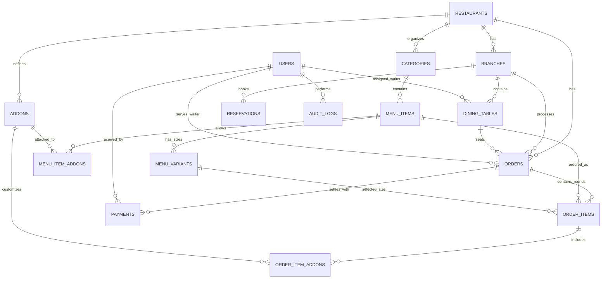

# RESTAURANT OS - PROJECT PROGRESS & ARCHITECTURE AUDIT

**Project Type:** Full-stack, Multi-tenant Restaurant Management System (Restaurant OS)  
**Current Phase:** Phase 6 Completed (Customer Website, Brand Portal, Contactless Table QR Ordering, Multi-round Cart & Live Prep Tracker, Table Bell Service Requests, and Online Table Reservations)  
**Frontend Deployment Target:** Vercel (Next.js 16 App Router, TypeScript, Tailwind CSS v4, Recharts, qrcode.react)  
**Backend Deployment Target:** Railway (Laravel 13 REST API, PHP 8.3, Sanctum, Spatie Permission)  
**Future Final Target:** Hostinger Unlimited Shared Hosting (Zero-daemon architecture, PHP + MySQL 8)  

---

## 1. Executive Summary of Phase 6 Deliverables

Phase 6 delivers the customer-facing experience for Restaurant OS, enabling diners to explore brand stories, book reservations, and order directly from their table via contactless QR codes without downloading an app or creating an account.

### Completed Features:

- [x] **Luxury Public Restaurant Brand Portal (`/`)**
  - **Editorial Hero & Heritage Story:** Styled using **DM Serif Display** editorial typography, warm terracotta (`#C76B4A`), and off-white backgrounds (`#FAF8F4`).
  - **Live Digital Menu Explorer:** Categorized dish browsing with allergen tags, spice meters (🌶️), vegetarian/non-vegetarian indicators, price formatting in INR (₹), and dietary filter chips.
  - **Multi-Branch Locator:** Displays location addresses, phone contacts, email, operating hours, and active dining tables count.
  - **Embedded Reservation Modal:** Guests can initiate booking directly from the homepage with instant date, time, and party size selection.

- [x] **Dedicated Reservation Booking System (`/reserve`)**
  - **Date & Time Picker:** Select booking date, dining time slots (lunch & dinner service), and guest party size (1–12 guests).
  - **Special Seating Preferences:** Dietary notes, high-chair requests, quiet booth preferences, or anniversary celebrations.
  - **Instant Confirmation:** Generates a real-time reservation record, confirms booking status, and logs guest contact details.

- [x] **Contactless Table QR Ordering Portal (`/order/[qrToken]`)**
  - **Token Resolution & Table Context:** Securely decodes the 36-character unguessable table token (`tbl_...`), instantly identifying the restaurant, branch, table number, seating zone, and current active order.
  - **Digital Menu Catalog:** Full menu exploration grouped by category with dietary filters and instant search.
  - **Portion & Variant Customization Drawer:** Modal for choosing portion sizes (Half, Full, Family Pack), spicy level overrides, and optional add-ons with cumulative price calculation.
  - **Slide-over Guest Cart:** Live order summary with subtotal, tax calculation, and special cooking instructions.
  - **Seamless Multi-Round Ordering:** When ordering from an already occupied table, automatically appends items to the ongoing dining session as an additional round (`Round 2`, `Round 3`) and dispatches a dedicated KOT without splitting the bill.
  - **Real-Time 4-Stage Preparation Tracker:** Live status stepper (Order Placed -> Kitchen Preparing -> Ready -> Served) with elapsed minutes, KOT number, and itemized round breakdown.
  - **Digital Table Bell Service Requests:** Diners can tap quick request buttons right from their phone:
    - 🔔 *Call Waiter* (Notifies floor staff with table number)
    - 💧 *Request Water* (Requests water refill)
    - 🧾 *Request Bill* (Alerts cashier to prepare the check)
    - 💬 *Custom Message* (Free-text inquiry or assistance note)

---

## 2. Default Seeded Test Personas

All staff accounts use password: `password123`

| Role | Email | Assigned Scope | Key Capabilities |
| :--- | :--- | :--- | :--- |
| **Super Admin** | `superadmin@resto.com` | Universal (All Tenants) | Full platform administration, analytics, tenant creation |
| **Restaurant Admin** | `admin@grandfeast.com` | The Grand Feast | Branch creation, menu catalog, staff assignment |
| **Branch Manager** | `manager@grandfeast.com` | Downtown Flagship | Branch operations, waiter assignment, daily sales |
| **Cashier / POS** | `cashier@grandfeast.com` | Downtown Flagship | POS ordering, table billing, payment collection |
| **Waiter** | `waiter@grandfeast.com` | Downtown Flagship | Handheld order pad, assigned tables, mark served |
| **Kitchen Chef** | `kitchen@grandfeast.com` | Downtown Flagship | Kitchen KDS queue, station routing, mark ready |
| **Guest / Diner** | *Public / No Login* | Table QR Token | View menu, place orders, digital table bell, reserve |

---

## 3. Database Schema Overview (Cumulative)



---

## 4. Automated Verification Results

```
Backend Test Suite (PHPUnit 12.5 / Laravel 13):
Tests: 47 passed, 0 failed (100% pass rate)
Assertions: 215
Duration: 24.10s

Feature Test Breakdown:
Phase 1: Authentication & Tenant Isolation
  ✓ test_health_check_returns_healthy_status
  ✓ test_bootstrap_returns_system_metadata
  ✓ test_super_admin_can_login
  ✓ test_login_fails_with_invalid_password
  ✓ test_deactivated_user_cannot_login
  ✓ test_authenticated_user_profile_and_logout
  ✓ test_user_can_change_password
  ✓ test_staff_cannot_access_unassigned_restaurant
  ✓ test_super_admin_can_access_any_restaurant
  ✓ test_audit_log_recorded_on_auth_events
  ✓ test_api_routes_available

Phase 2: Tenant & Staff Management
  ✓ test_super_admin_can_retrieve_dashboard_analytics
  ✓ test_unauthorized_user_cannot_view_analytics
  ✓ test_restaurant_crud_lifecycle
  ✓ test_cannot_archive_restaurant_with_active_orders
  ✓ test_branch_crud_lifecycle
  ✓ test_user_management_lifecycle
  ✓ test_role_and_permission_matrix

Phase 3: Menu, Tables & QR Verification
  ✓ test_category_lifecycle_and_deletion_safeguard
  ✓ test_menu_item_creation_with_variants_and_addons
  ✓ test_menu_item_availability_toggle
  ✓ test_addon_management
  ✓ test_dining_table_creation_and_uniqueness_per_branch
  ✓ test_table_qr_token_regeneration
  ✓ test_table_status_and_waiter_assignment
  ✓ test_occupied_table_cannot_be_deleted

Phase 4: Staff POS, KOT & Order Rounds
  ✓ test_cashier_can_create_dine_in_order_with_items_and_addons
  ✓ test_adding_items_to_occupied_table_creates_new_order_round
  ✓ test_waiter_can_update_dish_status_to_served
  ✓ test_bill_settlement_single_mode_cash
  ✓ test_bill_settlement_split_mode
  ✓ test_cannot_settle_already_paid_order
  ✓ test_cannot_settle_with_insufficient_payment
  ✓ test_cancel_order_with_mandatory_reason_and_free_table

Phase 5: Kitchen Display System (KDS)
  ✓ test_kitchen_staff_can_retrieve_kds_tickets
  ✓ test_kitchen_staff_can_filter_by_station
  ✓ test_chef_can_update_item_status
  ✓ test_chef_can_batch_mark_entire_ticket_as_ready
  ✓ test_kds_summary_metrics

Phase 6: Customer Website & QR Ordering Portal
  ✓ test_guest_can_retrieve_restaurant_public_profile
  ✓ test_guest_can_resolve_table_via_qr_token
  ✓ test_guest_can_place_order_via_qr_token
  ✓ test_guest_can_add_additional_round_via_qr_token
  ✓ test_guest_can_track_order_live_progress
  ✓ test_guest_can_send_table_service_request
  ✓ test_guest_can_book_table_reservation
  ✓ test_invalid_table_qr_returns_not_found

Frontend Build (Next.js 16.4.6 Turbopack):
  ✓ TypeScript type check passed (0 errors)
  ✓ Compiled routes (20/20 routes passing):
      ○ /                       [Phase 6 Public Brand Portal]
      ○ /_not-found
      ○ /audit-logs
      ○ /dashboard
      ○ /forgot-password
      ○ /kitchen                [Phase 5 Kitchen Display System]
      ○ /login
      ○ /menu
      ◐ /order/[qrToken]        [Phase 6 Contactless Table QR Ordering]
      ○ /pos                    [Phase 4 POS Terminal]
      ○ /reserve                [Phase 6 Online Table Reservations]
      ○ /reset-password
      ○ /restaurants
      ◐ /restaurants/[id]/branches
      ○ /roles
      ○ /tables
      ○ /users
      ○ /waiter                 [Phase 4 Waiter Station]
```

---

## 5. Next Phase: Phase 7 Scope

**Phase 7: Table Reservations, Inventory & Stock Management**
- Table Reservation Management:
  - Table allocation and auto-assignment based on guest party size.
  - Reservation status transitions (pending -> confirmed -> checked_in -> seated -> completed -> cancelled / no-show).
  - Conflict prevention for double bookings.
- Inventory & Raw Material Tracking:
  - Raw ingredients / inventory items table with units of measurement (kg, g, L, ml, pcs).
  - Current stock levels, safety stock thresholds, and minimum reorder points.
  - Low stock visual indicators and automated low stock alerts.
  - Recipe / Bill of Materials (BOM) linking menu items to ingredient deductions.
  - Supplier profiles and purchase order stock intake.
  - Stock adjustment logs with wastage, breakage, and audit tracking.
