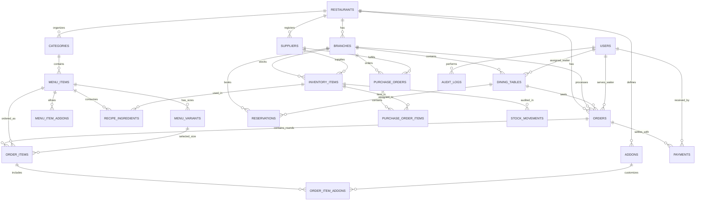

# RESTAURANT OS - PROJECT PROGRESS & ARCHITECTURE AUDIT

**Project Type:** Full-stack, Multi-tenant Restaurant Management System (Restaurant OS)  
**Current Phase:** Phase 7 Completed (Table Reservations Management, Real-time Conflict Safeguards, Inventory & Stock Tracking, Recipe BOMs, Suppliers & Purchase Orders Intake)  
**Frontend Deployment Target:** Vercel (Next.js 16 App Router, TypeScript, Tailwind CSS v4, Recharts, qrcode.react)  
**Backend Deployment Target:** Railway (Laravel 13 REST API, PHP 8.3, Sanctum, Spatie Permission)  
**Future Final Target:** Hostinger Unlimited Shared Hosting (Zero-daemon architecture, PHP + MySQL 8)  

---

## 1. Executive Summary of Phase 7 Deliverables

Phase 7 delivers end-to-end Table Reservations and Inventory / Supply Chain management for Restaurant OS.

### Completed Features:

- [x] **Table Reservations Management Interface (`/reservations`)**
  - **Comprehensive Operational Views:** Filter reservations by dining date, active branch, and status (`confirmed`, `checked_in`, `seated`, `completed`, `cancelled`, `no_show`).
  - **Live Search & Summary Metrics:** Quick filtering by guest name, phone, or email. Displays metrics for Today's Total Bookings, Confirmed/Upcoming, Currently Seated, and Expected Guest Count.
  - **One-Tap Guest Seating & Door Operations:** Instant "Seat Guest" action updates the reservation to `seated`, stamps `seated_at`, and automatically marks the dining table as `occupied`.
  - **Dynamic Table Assignment Modal:** Validates seating capacity against party size, displays current table status, and flags capacity fits.
  - **Time-Slot Conflict Prevention Engine:** Automated check verifies that no active booking overlaps on the same table within a 90-minute service buffer, preventing double bookings.
  - **Staff Booking Modal:** Allows restaurant staff to manually book phone-in or walk-in reservations directly into the system.

- [x] **Inventory & Raw Materials Operating System (`/inventory`)**
  - **Multi-Tab Workspace:** Fast switching across Stock Items, Low Stock Alerts, Suppliers Directory, and Purchase Orders.
  - **Raw Material Tracking:** Categorized ingredient inventory (produce, meat, poultry, seafood, dairy, spices, dry goods, beverages, packaging) with units of measurement (`kg`, `g`, `l`, `ml`, `pcs`, `pack`, `box`).
  - **Stock Health & Automatic Status:** Real-time stock status computation:
    - `in_stock`: Healthy stock above safety thresholds.
    - `low_stock`: Dips below configured minimum reorder point.
    - `out_of_stock`: Depleted or zero quantity.
  - **Dedicated Low Stock Alerts View:** Highlights critical shortages with calculated deficit quantities and one-click purchase order triggers.
  - **Audited Stock Movements Ledger:** All additions, kitchen wastage, spoilage, audit count corrections, and supplier returns are recorded with delta, new balance, unit costs, reason, and auditor notes.

- [x] **Suppliers Directory & Vendor Management**
  - **Vendor Profiles:** Complete management of suppliers with business name, representative contact, phone, email, warehouse address, GST/tax number, and credit payment terms (`net_15`, `net_30`, `cod`, `advance`).
  - **Supplier Association:** Associates raw ingredients and purchase orders with designated vendors.

- [x] **Purchase Orders & Goods Intake Automation**
  - **Purchase Order Generator:** Generates unique PO numbers (`PO-YYYYMMDD-XXXX`), order date, expected delivery date, multi-item line rows, subtotal, and 5% input GST.
  - **Interactive Shipment Intake Modal:** Receiving goods against a PO immediately updates item received quantities, automatically increments the inventory `current_stock` balance, recalculates stock status, and logs a `purchase_in` stock movement.

- [x] **Recipe Bill of Materials (BOM) System**
  - **Ingredient Deductions Engine:** Connects menu dishes and their variants to raw ingredient quantities.

---

## 2. Default Seeded Test Personas

All staff accounts use password: `password123`

| Role | Email | Assigned Scope | Key Capabilities |
| :--- | :--- | :--- | :--- |
| **Super Admin** | `superadmin@resto.com` | Universal (All Tenants) | Full platform administration, analytics, tenant creation |
| **Restaurant Admin** | `admin@grandfeast.com` | The Grand Feast | Branch creation, menu catalog, staff assignment |
| **Branch Manager** | `manager@grandfeast.com` | Downtown Flagship | Branch operations, reservations, inventory, daily sales |
| **Cashier / POS** | `cashier@grandfeast.com` | Downtown Flagship | POS ordering, table billing, payment collection |
| **Waiter** | `waiter@grandfeast.com` | Downtown Flagship | Handheld order pad, assigned tables, mark served |
| **Kitchen Chef** | `kitchen@grandfeast.com` | Downtown Flagship | Kitchen KDS queue, station routing, mark ready |
| **Guest / Diner** | *Public / No Login* | Table QR Token | View menu, place orders, digital table bell, reserve |

---

## 3. Database Schema Overview (Cumulative)



---

## 4. Automated Verification Results

```
Backend Test Suite (PHPUnit 12.5 / Laravel 13):
Tests: 56 passed, 0 failed (100% pass rate)
Assertions: 250
Duration: 45.71s

Feature Test Breakdown:
Phase 1: Authentication & Tenant Isolation
  ✓ test_health_check_returns_healthy_status
  ✓ test_bootstrap_returns_system_metadata
  ✓ test_super_admin_can_login
  ✓ test_login_fails_with_invalid_password
  ✓ test_deactivated_user_cannot_login
  ✓ test_authenticated_user_profile_and_logout
  ✓ test_user_can_change_password
  ✓ test_staff_cannot_access_unassigned_restaurant
  ✓ test_super_admin_can_access_any_restaurant
  ✓ test_audit_log_recorded_on_auth_events
  ✓ test_api_routes_available

Phase 2: Tenant & Staff Management
  ✓ test_super_admin_can_retrieve_dashboard_analytics
  ✓ test_unauthorized_user_cannot_view_analytics
  ✓ test_restaurant_crud_lifecycle
  ✓ test_cannot_archive_restaurant_with_active_orders
  ✓ test_branch_crud_lifecycle
  ✓ test_user_management_lifecycle
  ✓ test_role_and_permission_matrix

Phase 3: Menu, Tables & QR Verification
  ✓ test_category_lifecycle_and_deletion_safeguard
  ✓ test_menu_item_creation_with_variants_and_addons
  ✓ test_menu_item_availability_toggle
  ✓ test_addon_management
  ✓ test_dining_table_creation_and_uniqueness_per_branch
  ✓ test_table_qr_token_regeneration
  ✓ test_table_status_and_waiter_assignment
  ✓ test_occupied_table_cannot_be_deleted

Phase 4: Staff POS, KOT & Order Rounds
  ✓ test_cashier_can_create_dine_in_order_with_items_and_addons
  ✓ test_adding_items_to_occupied_table_creates_new_order_round
  ✓ test_waiter_can_update_dish_status_to_served
  ✓ test_bill_settlement_single_mode_cash
  ✓ test_bill_settlement_split_mode
  ✓ test_cannot_settle_already_paid_order
  ✓ test_cannot_settle_with_insufficient_payment
  ✓ test_cancel_order_with_mandatory_reason_and_free_table

Phase 5: Kitchen Display System (KDS)
  ✓ test_kitchen_staff_can_retrieve_kds_tickets
  ✓ test_kitchen_staff_can_filter_by_station
  ✓ test_chef_can_update_item_status
  ✓ test_chef_can_batch_mark_entire_ticket_as_ready
  ✓ test_kds_summary_metrics

Phase 6: Customer Website & QR Ordering Portal
  ✓ test_guest_can_retrieve_restaurant_public_profile
  ✓ test_guest_can_resolve_table_via_qr_token
  ✓ test_guest_can_place_order_via_qr_token
  ✓ test_guest_can_add_additional_round_via_qr_token
  ✓ test_guest_can_track_order_live_progress
  ✓ test_guest_can_send_table_service_request
  ✓ test_guest_can_book_table_reservation
  ✓ test_invalid_table_qr_returns_not_found

Phase 7: Table Reservations, Inventory & Stock Management
  ✓ test_staff_can_list_and_filter_reservations
  ✓ test_staff_can_create_reservation_with_table
  ✓ test_cannot_assign_table_with_conflicting_time_slot
  ✓ test_staff_can_seat_guest_and_occupy_table
  ✓ test_supplier_crud_lifecycle
  ✓ test_inventory_item_creation_and_minimum_stock_alerting
  ✓ test_stock_adjustment_creates_movement_and_updates_status
  ✓ test_purchase_order_creation_and_stock_receipt_intake
  ✓ test_recipe_bom_ingredients_save_and_retrieve

Frontend Build (Next.js 16.4.6 Turbopack):
  ✓ TypeScript type check passed (0 errors)
  ✓ Compiled routes (22/22 routes passing):
      ○ /                       [Phase 6 Public Brand Portal]
      ○ /_not-found
      ○ /audit-logs
      ○ /dashboard
      ○ /forgot-password
      ○ /inventory              [Phase 7 Raw Materials, Alerts, Suppliers & POs]
      ○ /kitchen                [Phase 5 Kitchen Display System]
      ○ /login
      ○ /menu
      ◐ /order/[qrToken]        [Phase 6 Contactless Table QR Ordering]
      ○ /pos                    [Phase 4 POS Terminal]
      ○ /reservations           [Phase 7 Table Reservations & Seating]
      ○ /reserve                [Phase 6 Online Table Reservations]
      ○ /reset-password
      ○ /restaurants
      ◐ /restaurants/[id]/branches
      ○ /roles
      ○ /tables
      ○ /users
      ○ /waiter                 [Phase 4 Waiter Station]
```

---

## 5. Next Phase: Phase 8 Scope

**Phase 8: Business Analytics, Reports, Multi-Restaurant SaaS Commercialization & Final Hostinger Deployment Prep**
- Advanced Business Analytics:
  - Daily, weekly, and monthly revenue trends.
  - Category and item-level profitability analysis.
  - Table turnaround time and floor occupancy rate.
  - Waitstaff sales attribution and tips ledger.
  - Customer retention & repeat dining frequency.
- Exportable Reports:
  - End-of-Day (EOD) Z-Reports for Cashier balancing.
  - Tax & GST summary reports (CGST / SGST breakdown).
  - Inventory consumption & wastage audit reports.
- Multi-Restaurant SaaS Commercialization:
  - Restaurant subscription tiers & plan limits (e.g. Starter, Pro, Enterprise).
  - Tenant feature flags.
  - Hostinger Unlimited Shared Hosting deployment scripts and zero-daemon scheduler configuration (`cron.php` / Artisan scheduler triggers).
