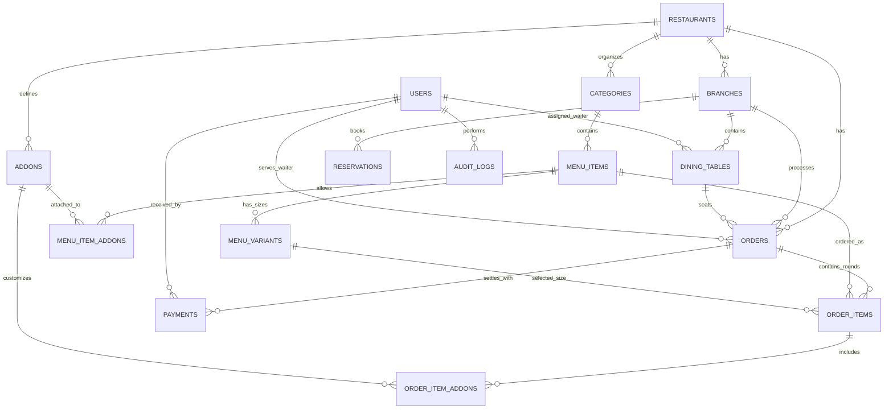

# RESTAURANT OS - PROJECT PROGRESS & ARCHITECTURE AUDIT

**Project Type:** Full-stack, Multi-tenant Restaurant Management System (Restaurant OS)  
**Current Phase:** Phase 4 Completed (Staff POS, Order Rounds, KOT Dispatch, Waiter Station & Bill Settlement)  
**Frontend Deployment Target:** Vercel (Next.js 16 App Router, TypeScript, Tailwind CSS v4, Recharts, qrcode.react)  
**Backend Deployment Target:** Railway (Laravel 13 REST API, PHP 8.3, Sanctum, Spatie Permission)  
**Future Final Target:** Hostinger Unlimited Shared Hosting (Zero-daemon architecture, PHP + MySQL 8)  

---

## 1. Executive Summary of Phase 4 Deliverables

Phase 4 delivers the complete operational core of **Restaurant OS**: a high-speed cashier POS terminal, automated Order Rounds, KOT ticket generation, split bill settlement, and a mobile-optimized handheld Waiter Station.

### Completed Features:

- [x] **High-Speed Staff POS Terminal (`/pos`)**
  - **Multi-Service Modes:** Fast toggle between **Dine-In**, **Takeaway** (packaging charge support), and **Delivery**.
  - **Visual Table Strip:** Real-time table status chips (Available = Green, Occupied = Blue, Billed = Purple).
  - **Active Table Order Detection:** Selecting an occupied table immediately detects the active order session, displays the active order number and round count, and switches into "Add Round" mode.
  - **Category & Item Browsing:** Horizontal category pills, fast veg/non-veg filter pills, instant name/code search.
  - **Customization Modal:** Portion/variant selection (e.g. *Regular* vs *Family Pack*), customizable add-on checkboxes with dynamic price calculation, and kitchen notes input (e.g. *"Less spicy, no coriander"*).

- [x] **Order Rounds & KOT Ticket Dispatch**
  - **Multi-Round Ordering:** When additional items are ordered for an occupied table, they are automatically batched into an incremental round (Round 1, Round 2, Round 3) while keeping a single consolidated bill.
  - **Kitchen Order Ticket (KOT):** Each round generates an unpredictable sequential ticket (`KOT-YYYYMMDD-XXX`) routing items to their designated kitchen station (`main`, `grill`, `tandoor`, `biryani`, `beverage`, `dessert`).
  - **KOT Preview Modal:** Printable ticket with ticket number, table number, server, item portions, and special instructions.

- [x] **Bill Settlement & Split Payment Collection**
  - **Multi-Mode Payments:** Single or Split payment support across **Cash**, **Card**, and **UPI**.
  - **Cash Tender & Change Engine:** Pre-configured denomination buttons (₹500, ₹1000, ₹2000), cash received input, and automatic change return calculation.
  - **Split Settlement:** Enter multiple payment splits (e.g., part Cash, part UPI) with live validation preventing under-payment.
  - **Tax Invoice Receipt Modal:** Generates unique sequential tax invoice numbers (`INV-YYYYMMDD-XXXX`), full itemized tax breakdown (5% GST), and thermal receipt printing layout.
  - **Table Auto-Reset:** Automatically transitions table status to `cleaning` upon bill settlement.

- [x] **Mobile-Optimized Waiter Station (`/waiter`)**
  - **Handheld-First Design:** Optimized for 5–7 inch mobile phone and tablet touchscreens.
  - **Floor Shift Dashboard:** Logged-in waiter details (*Arun*), live shift counters (My Tables, Occupied, Ready to Serve).
  - **Filter Tabs:** *All Tables*, *My Assigned Tables*, *Occupied*, *Ready to Serve*.
  - **Real-Time Dish Prep Tracker:** Displays item status directly from the kitchen (`pending`, `preparing`, `ready`, `served`).
  - **One-Tap "Mark Served":** Instant button to mark food as served when kitchen marks dishes ready.
  - **Rapid Order Pad Drawer:** Fast handheld ordering directly at the guest's table with category filters and instant kitchen firing.
  - **Quick Status Dialog:** Instant table status switcher (*Available*, *Occupied*, *Billed*, *Cleaning*).

---

## 2. Default Seeded Test Personas

All accounts use password: `password123`

| Role | Email | Assigned Scope | Key Capabilities |
| :--- | :--- | :--- | :--- |
| **Super Admin** | `superadmin@resto.com` | Universal (All Tenants) | Full platform administration, analytics, tenant creation |
| **Restaurant Admin** | `admin@grandfeast.com` | The Grand Feast | Branch creation, menu catalog, staff assignment |
| **Branch Manager** | `manager@grandfeast.com` | Downtown Flagship | Branch operations, waiter assignment, daily sales |
| **Cashier / POS** | `cashier@grandfeast.com` | Downtown Flagship | POS ordering, table billing, payment collection |
| **Waiter** | `waiter@grandfeast.com` | Downtown Flagship | Handheld order pad, assigned tables, mark served |
| **Kitchen Chef** | `kitchen@grandfeast.com` | Downtown Flagship | Kitchen KDS queue, preparation status |

---

## 3. Database Schema Overview (Phase 1 through Phase 4)



---

## 4. Automated Verification Results

```
Backend Test Suite (PHPUnit 12.5 / Laravel 13):
Tests: 34 passed, 0 failed (100% pass rate)
Assertions: 155
Duration: 13.51s

Feature Test Breakdown:
Phase 1: Authentication & Tenant Isolation
  ✓ test_health_check_returns_healthy_status
  ✓ test_bootstrap_returns_system_metadata
  ✓ test_super_admin_can_login
  ✓ test_login_fails_with_invalid_password
  ✓ test_deactivated_user_cannot_login
  ✓ test_authenticated_user_profile_and_logout
  ✓ test_user_can_change_password
  ✓ test_staff_cannot_access_unassigned_restaurant
  ✓ test_super_admin_can_access_any_restaurant
  ✓ test_audit_log_recorded_on_auth_events
  ✓ test_api_routes_available

Phase 2: Tenant & Staff Management
  ✓ test_super_admin_can_retrieve_dashboard_analytics
  ✓ test_unauthorized_user_cannot_view_analytics
  ✓ test_restaurant_crud_lifecycle
  ✓ test_cannot_archive_restaurant_with_active_orders
  ✓ test_branch_crud_lifecycle
  ✓ test_user_management_lifecycle
  ✓ test_role_and_permission_matrix

Phase 3: Menu, Tables & QR Verification
  ✓ test_category_lifecycle_and_deletion_safeguard
  ✓ test_menu_item_creation_with_variants_and_addons
  ✓ test_menu_item_availability_toggle
  ✓ test_addon_management
  ✓ test_dining_table_creation_and_uniqueness_per_branch
  ✓ test_table_qr_token_regeneration
  ✓ test_table_status_and_waiter_assignment
  ✓ test_occupied_table_cannot_be_deleted

Phase 4: Staff POS, KOT & Order Rounds
  ✓ test_cashier_can_create_dine_in_order_with_items_and_addons
  ✓ test_adding_items_to_occupied_table_creates_new_order_round
  ✓ test_waiter_can_update_dish_status_to_served
  ✓ test_bill_settlement_single_mode_cash
  ✓ test_bill_settlement_split_mode
  ✓ test_cannot_settle_already_paid_order
  ✓ test_cannot_settle_with_insufficient_payment
  ✓ test_cancel_order_with_mandatory_reason_and_free_table

Frontend Build (Next.js 16 Turbopack):
  ✓ TypeScript type check passed (0 errors)
  ✓ Compiled routes:
      ○ /
      ○ /_not-found
      ○ /audit-logs
      ○ /dashboard
      ○ /forgot-password
      ○ /login
      ○ /menu
      ○ /pos            [Phase 4 POS Terminal]
      ○ /reset-password
      ○ /restaurants
      ◐ /restaurants/[id]/branches
      ○ /roles
      ○ /tables
      ○ /users
      ○ /waiter         [Phase 4 Waiter Station]
```

---

## 5. Next Phase: Phase 5 Scope

**Phase 5: Kitchen Display System (KDS)**
- Real-time kitchen view organized by cooking station (`main`, `grill`, `tandoor`, `biryani`, `beverage`, `dessert`).
- Ticket priority indicators: preparation timers, overdue warning alerts (e.g. >20 mins elapsed).
- KDS Station selector for station-specific kitchen screens.
- Interactive status stepping: Start Preparing (`preparing`) -> Ready for Pickup (`ready`) with audio cue/alert.
- Cancellation and modification alerts directly on KDS screens.
- Order round badges on KOT tickets.
