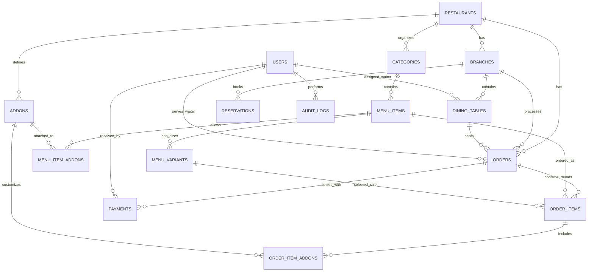

# RESTAURANT OS - PROJECT PROGRESS & ARCHITECTURE AUDIT

**Project Type:** Full-stack, Multi-tenant Restaurant Management System (Restaurant OS)  
**Current Phase:** Phase 5 Completed (Kitchen Display System, Station Routing, Timers, Urgency Alerts & KDS Metrics)  
**Frontend Deployment Target:** Vercel (Next.js 16 App Router, TypeScript, Tailwind CSS v4, Recharts, qrcode.react)  
**Backend Deployment Target:** Railway (Laravel 13 REST API, PHP 8.3, Sanctum, Spatie Permission)  
**Future Final Target:** Hostinger Unlimited Shared Hosting (Zero-daemon architecture, PHP + MySQL 8)  

---

## 1. Executive Summary of Phase 5 Deliverables

Phase 5 introduces the high-contrast **Kitchen Display System (KDS)**, connecting floor operations and waitstaff directly with chefs across specialized kitchen preparation stations.

### Completed Features:

- [x] **Kitchen Display System Interface (`/kitchen`)**
  - **High-Contrast Dark-on-White Kitchen Layout:** Built specifically for chef visibility and quick touch interactions in busy kitchen environments.
  - **Station Routing Tabs:** Allows locking any kitchen display screen into a specific prep station or viewing the master kitchen queue:
    - `All Stations` (Master Kitchen Controller)
    - `Main Curries` (`main`)
    - `Dum Biryani` (`biryani`)
    - `Clay Tandoor` (`tandoor`)
    - `Grill & Kebabs` (`grill`)
    - `Bar & Beverages` (`beverage`)
    - `Desserts & Sweets` (`dessert`)
  - **Live Station Summary Metrics:** Header bar displaying real-time counts for pending dishes, currently cooking items, ready-for-pickup dishes, and overdue tickets.

- [x] **Preparation Timers & Color-Coded Urgency**
  - **Elapsed Time Tracking:** Dynamic clock tracking minutes elapsed since each ticket was fired by POS or Waitstaff.
  - **3-Tier Urgency Thresholds:**
    - **Normal (< 10 mins):** Subtle border (`#EAE7E0`), green timer badge (`#39845C`).
    - **Attention (10–20 mins):** Amber warning border (`#D69A3A`) and amber timer badge.
    - **Overdue (> 20 mins):** High-visibility red alert border (`#C84D4D`), red timer badge with visual pulse.

- [x] **Ticket Layout & Dish Preparation Stepper**
  - **Ticket Cards:** Displays KOT number (monospace font), Table number (or Takeaway / Delivery badge), Table location, Server name, and incremental Round Badges (`ROUND 2` in bold terracotta).
  - **Item Details:** Large bold quantity multiplier, portion size badge (e.g. *Family Pack*), customizable add-ons list.
  - **Cooking Notes Banner:** High-visibility amber banner highlighting guest allergies and preferences (e.g. *"⚠️ Note: Less spicy, no coriander"*).
  - **Step-by-Step Status Flow:**
    - Tap **`Start Prep`** (`pending` -> `preparing` with cooking flame icon).
    - Tap **`Cooking...`** (`preparing` -> `ready` with checkmark icon).
    - Automatically updates the master order status and notifies floor waitstaff.
  - **One-Click Batch "Mark Whole Ticket Ready":** Completes all pending dishes on the ticket simultaneously and alerts the waitstaff for pickup.

- [x] **Synthesizer Kitchen Chime & Recall Mode**
  - **Zero-Dependency Audio Chime:** Built-in Web Audio API synthesizer that chimes when new tickets are fired to the kitchen.
  - **Recall Completed Mode:** Toggle to inspect recently completed or served tickets from the past 4 hours in case of customer or waitstaff queries.
  - **Real-Time Polling:** Synchronizes live kitchen state every 5 seconds.

---

## 2. Default Seeded Test Personas

All accounts use password: `password123`

| Role | Email | Assigned Scope | Key Capabilities |
| :--- | :--- | :--- | :--- |
| **Super Admin** | `superadmin@resto.com` | Universal (All Tenants) | Full platform administration, analytics, tenant creation |
| **Restaurant Admin** | `admin@grandfeast.com` | The Grand Feast | Branch creation, menu catalog, staff assignment |
| **Branch Manager** | `manager@grandfeast.com` | Downtown Flagship | Branch operations, waiter assignment, daily sales |
| **Cashier / POS** | `cashier@grandfeast.com` | Downtown Flagship | POS ordering, table billing, payment collection |
| **Waiter** | `waiter@grandfeast.com` | Downtown Flagship | Handheld order pad, assigned tables, mark served |
| **Kitchen Chef** | `kitchen@grandfeast.com` | Downtown Flagship | Kitchen KDS queue, station routing, mark ready |

---

## 3. Database Schema Overview (Cumulative)



---

## 4. Automated Verification Results

```
Backend Test Suite (PHPUnit 12.5 / Laravel 13):
Tests: 39 passed, 0 failed (100% pass rate)
Assertions: 186
Duration: 18.26s

Feature Test Breakdown:
Phase 1: Authentication & Tenant Isolation
  ✓ test_health_check_returns_healthy_status
  ✓ test_bootstrap_returns_system_metadata
  ✓ test_super_admin_can_login
  ✓ test_login_fails_with_invalid_password
  ✓ test_deactivated_user_cannot_login
  ✓ test_authenticated_user_profile_and_logout
  ✓ test_user_can_change_password
  ✓ test_staff_cannot_access_unassigned_restaurant
  ✓ test_super_admin_can_access_any_restaurant
  ✓ test_audit_log_recorded_on_auth_events
  ✓ test_api_routes_available

Phase 2: Tenant & Staff Management
  ✓ test_super_admin_can_retrieve_dashboard_analytics
  ✓ test_unauthorized_user_cannot_view_analytics
  ✓ test_restaurant_crud_lifecycle
  ✓ test_cannot_archive_restaurant_with_active_orders
  ✓ test_branch_crud_lifecycle
  ✓ test_user_management_lifecycle
  ✓ test_role_and_permission_matrix

Phase 3: Menu, Tables & QR Verification
  ✓ test_category_lifecycle_and_deletion_safeguard
  ✓ test_menu_item_creation_with_variants_and_addons
  ✓ test_menu_item_availability_toggle
  ✓ test_addon_management
  ✓ test_dining_table_creation_and_uniqueness_per_branch
  ✓ test_table_qr_token_regeneration
  ✓ test_table_status_and_waiter_assignment
  ✓ test_occupied_table_cannot_be_deleted

Phase 4: Staff POS, KOT & Order Rounds
  ✓ test_cashier_can_create_dine_in_order_with_items_and_addons
  ✓ test_adding_items_to_occupied_table_creates_new_order_round
  ✓ test_waiter_can_update_dish_status_to_served
  ✓ test_bill_settlement_single_mode_cash
  ✓ test_bill_settlement_split_mode
  ✓ test_cannot_settle_already_paid_order
  ✓ test_cannot_settle_with_insufficient_payment
  ✓ test_cancel_order_with_mandatory_reason_and_free_table

Phase 5: Kitchen Display System (KDS)
  ✓ test_kitchen_staff_can_retrieve_kds_tickets
  ✓ test_kitchen_staff_can_filter_by_station
  ✓ test_chef_can_update_item_status
  ✓ test_chef_can_batch_mark_entire_ticket_as_ready
  ✓ test_kds_summary_metrics

Frontend Build (Next.js 16 Turbopack):
  ✓ TypeScript type check passed (0 errors)
  ✓ Compiled routes:
      ○ /
      ○ /_not-found
      ○ /audit-logs
      ○ /dashboard
      ○ /forgot-password
      ○ /kitchen        [Phase 5 Kitchen Display System]
      ○ /login
      ○ /menu
      ○ /pos            [Phase 4 POS Terminal]
      ○ /reset-password
      ○ /restaurants
      ◐ /restaurants/[id]/branches
      ○ /roles
      ○ /tables
      ○ /users
      ○ /waiter         [Phase 4 Waiter Station]
```

---

## 5. Next Phase: Phase 6 Scope

**Phase 6: Customer Website & QR Ordering Portal**
- Public customer restaurant website (`/` and `/[restaurantSlug]`) with DM Serif Display branding.
- Contactless Table QR Ordering (`/order/[qrToken]`):
  - Direct customer menu browsing without login required.
  - Portions, variants, and addon selection.
  - Cart drawer and instant table order placement.
  - Real-time customer order tracking screen (Order Placed -> Kitchen Preparing -> Ready -> Served).
  - Digital Table Bell ("Call Waiter", "Request Water", "Request Bill").
- Table Reservation Portal (`/reserve`):
  - Date & time picker, guest count, seating preferences.
  - Instant booking confirmation.
