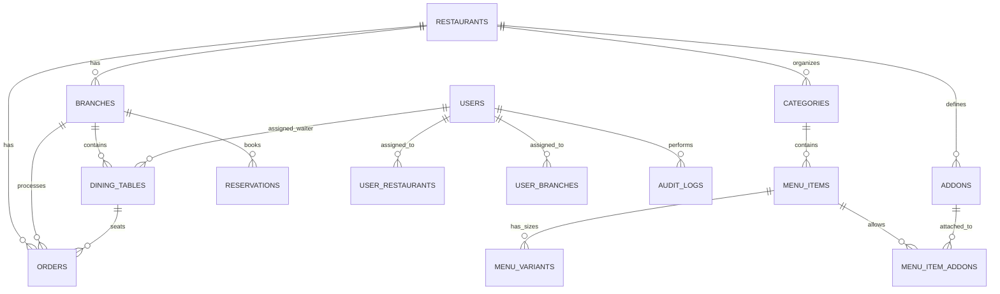

# RESTAURANT OS - PROJECT PROGRESS & ARCHITECTURE AUDIT

**Project Type:** Full-stack, Multi-tenant Restaurant Management System (Restaurant OS)  
**Current Phase:** Phase 3 Completed (Menu Catalog, Variants, Addons, Dining Tables & Secure QR System)  
**Frontend Deployment Target:** Vercel (Next.js 16 App Router, TypeScript, Tailwind CSS v4, Recharts, qrcode.react)  
**Backend Deployment Target:** Railway (Laravel 13 REST API, PHP 8.3, Sanctum, Spatie Permission)  
**Future Final Target:** Hostinger Unlimited Shared Hosting (Zero-daemon architecture, PHP + MySQL 8)  

---

## 1. Executive Summary of Phase 3 Deliverables

Phase 3 introduces the complete Menu & Table Management engine, giving restaurants fine-grained catalog control, kitchen routing, variant pricing, dynamic add-ons, visual table layout monitoring, and instant contactless QR ordering capabilities.

### Completed Features:

- [x] **Menu Categories & Subcategories (`/menu`)**
  - Category creation with name, slug, description, sort order, and active/inactive toggle.
  - Category deletion safeguard: prevents deleting a category that still contains active menu items.
  - Quick Category filter tabs with live item count badges.

- [x] **Food Items Catalog & Dish Configuration**
  - Full CRUD operations with instant audit logging (`menu_item.created`, `menu_item.updated`, `menu_item.deleted`).
  - Dish details: Name, slug, description, image URL, base price, tax rate (%), preparation time (minutes).
  - Food classification: Vegetarian (Green dot), Non-Vegetarian (Red dot), Egg (Amber dot), Vegan (Leaf badge).
  - Kitchen routing: Assign items to specific kitchen stations (`main`, `grill`, `tandoor`, `biryani`, `beverage`, `dessert`).
  - Featured item and combo meal flags.
  - Live in-stock / out-of-stock availability toggle button on cards with instant backend sync.

- [x] **Multi-Variant Pricing & Customization Addons**
  - Flexible variant options per dish (e.g., *Half* vs *Full*, *Regular* vs *Jumbo Family Pack*), each with independent pricing and default selection.
  - Add-on system (e.g., *Extra Chicken*, *Extra Egg*, *Cheese*, *Extra Salan Gravy*) with custom add-on pricing attached directly to menu items.

- [x] **Interactive Dining Table Floor Grid (`/tables`)**
  - Visual floor layout with table cards showing seating capacity, current status, location, assigned waiter, and QR preview.
  - Status management: `Available` (Green), `Occupied` (Blue), `Reserved` (Amber), `Billed` (Purple), `Cleaning` (Teal), `Out of Service` (Red).
  - Quick status dropdown for floor captains and staff to update table status with one click.
  - Direct Waiter Assignment modal connecting waitstaff directly to active dining tables.
  - Real-time status summary counter badges: Available, Occupied, Reserved, Billed, Cleaning.
  - Location filtering: All, Main Dining Hall, AC Family Section, Rooftop Terrace, Outdoor Garden.
  - Deletion safeguard: prevents deleting tables currently marked as `occupied`.

- [x] **Secure, Unpredictable QR Code Generation & Standee Preview**
  - Automated 36-character random alphanumeric tokens (`tbl_` + 32 random characters). Raw sequential auto-incrementing table IDs are never exposed.
  - Standee Preview Modal with high-contrast SVG QR code (rendered via `qrcode.react`).
  - Table Standee print & SVG/PNG download workflow with restaurant branding and table number.
  - One-click QR token regeneration to instantly revoke compromised or outdated table standees.

---

## 2. Default Seeded Test Personas

All accounts use password: `password123`

| Role | Email | Assigned Scope | Key Capabilities |
| :--- | :--- | :--- | :--- |
| **Super Admin** | `superadmin@resto.com` | Universal (All Tenants) | Full platform administration, analytics, tenant creation |
| **Restaurant Admin** | `admin@grandfeast.com` | The Grand Feast | Branch creation, menu catalog, staff assignment |
| **Branch Manager** | `manager@grandfeast.com` | Downtown Flagship | Branch operations, waiter assignment, daily sales |
| **Cashier / POS** | `cashier@grandfeast.com` | Downtown Flagship | POS ordering, table billing, payment collection |
| **Waiter** | `waiter@grandfeast.com` | Downtown Flagship | Assigned tables, mobile order round entry |
| **Kitchen Chef** | `kitchen@grandfeast.com` | Downtown Flagship | Kitchen KDS queue, preparation status |

---

## 3. Database Schema Overview (Phase 1, 2 & 3)



---

## 4. API Endpoints Catalog (Cumulative)

Base URL: `/api/v1/`

### Public & Authentication
- `GET /health` – Real-time health and database connectivity.
- `GET /bootstrap` – Public metadata, active tenant list, and design tokens.
- `POST /auth/login` – Rate-limited user authentication.
- `POST /auth/forgot-password` – Password recovery token generation.
- `POST /auth/reset-password` – Set new password with token.
- `GET /auth/me` – Authenticated user profile and permissions.
- `POST /auth/change-password` – User password self-update.
- `POST /auth/logout` – Revoke active session token.

### Super Admin & Analytics
- `GET /super-admin/dashboard` – Real-time multi-restaurant analytics, 7-day revenue trend, order volume, restaurant performance, and recent activity.

### Restaurant & Branch Management
- `GET /restaurants` – Paginated and searchable restaurants list.
- `POST /restaurants` – Create new restaurant entity with settings.
- `GET /restaurants/{id}` – Get restaurant details with branches and staff count.
- `PUT /restaurants/{id}` – Update restaurant attributes and settings.
- `DELETE /restaurants/{id}` – Archive restaurant (with active order safeguards).
- `POST /restaurants/{id}/toggle-status` – Toggle active/inactive state.
- `GET /restaurants/{id}/branches` – List all branches for a restaurant.
- `POST /restaurants/{id}/branches` – Create physical branch location.
- `GET /restaurants/{id}/branches/{branchId}` – Get branch details.
- `PUT /restaurants/{id}/branches/{branchId}` – Update branch details, hours, and tax rate.
- `DELETE /restaurants/{id}/branches/{branchId}` – Archive branch with safeguards.
- `POST /restaurants/{id}/branches/{branchId}/toggle-status` – Toggle branch active status.

### User & Staff Management
- `GET /users` – List users with role, restaurant, and search filters.
- `POST /users` – Provision new staff member with roles and restaurant assignments.
- `GET /users/{id}` – Get user profile, roles, and assigned scopes.
- `PUT /users/{id}` – Update user profile, roles, and restaurant assignments.
- `DELETE /users/{id}` – Archive user (safeguards against self-deletion).
- `POST /users/{id}/toggle-status` – Activate/deactivate user account.
- `POST /users/{id}/reset-password` – Admin direct password reset.

### Roles & Permissions Matrix
- `GET /roles` – List all roles and grouped permissions across 14 modules.
- `POST /roles` – Create custom role.
- `PUT /roles/{id}` – Update role permissions.
- `DELETE /roles/{id}` – Delete custom role (system roles protected).

### Menu Categories & Dishes
- `GET /categories` – List categories with active item counts.
- `POST /categories` – Create category.
- `GET /categories/{id}` – Get category details with menu items.
- `PUT /categories/{id}` – Update category.
- `DELETE /categories/{id}` – Delete category (safeguards against deleting with items).
- `GET /menu-items` – List menu items with search, category, type, and station filters.
- `POST /menu-items` – Create menu item with variants and addons.
- `GET /menu-items/{id}` – Menu item details with variants and addons.
- `PUT /menu-items/{id}` – Update menu item.
- `DELETE /menu-items/{id}` – Soft-delete menu item.
- `POST /menu-items/{id}/toggle-availability` – Instant in-stock/out-of-stock toggle.
- `GET /addons` – List customizable addons.
- `POST /addons` – Create addon.
- `PUT /addons/{id}` – Update addon.
- `DELETE /addons/{id}` – Delete addon.

### Dining Tables & QR System
- `GET /tables` – List dining tables with branch, location, status filters, and assigned waiter.
- `POST /tables` – Create dining table (generates unique unpredictable QR token automatically).
- `GET /tables/{id}` – Get table details with QR code and active orders.
- `PUT /tables/{id}` – Update table configuration.
- `DELETE /tables/{id}` – Delete table (safeguarded against deleting occupied tables).
- `POST /tables/{id}/qr` & `POST /tables/{id}/generate-qr` – Regenerate unpredictable QR token.
- `POST /tables/{id}/assign-waiter` & `PATCH /tables/{id}/waiter` – Assign staff waiter.
- `POST /tables/{id}/status` & `PATCH /tables/{id}/status` – Update table floor status.

### System & Audit
- `GET /audit-logs` – Paginated audit events.
- `GET /tenant/verify` – Tenant isolation verification.

---

## 5. Automated Verification Results

```
Backend Test Suite (PHPUnit 12.5 / Laravel 13):
Tests: 25 passed, 0 failed (100% pass rate)
Assertions: 112
Duration: 10.55s

Feature Test Breakdown:
Phase 1: Authentication & Tenant Isolation
  ✓ test_health_check_returns_healthy_status
  ✓ test_bootstrap_returns_system_metadata
  ✓ test_super_admin_can_login
  ✓ test_login_fails_with_invalid_password
  ✓ test_deactivated_user_cannot_login
  ✓ test_authenticated_user_profile_and_logout
  ✓ test_user_can_change_password
  ✓ test_staff_cannot_access_unassigned_restaurant
  ✓ test_super_admin_can_access_any_restaurant
  ✓ test_audit_log_recorded_on_auth_events
  ✓ test_api_routes_available

Phase 2: Tenant & Staff Management
  ✓ test_super_admin_can_retrieve_dashboard_analytics
  ✓ test_unauthorized_user_cannot_view_analytics
  ✓ test_restaurant_crud_lifecycle
  ✓ test_cannot_archive_restaurant_with_active_orders
  ✓ test_branch_crud_lifecycle
  ✓ test_user_management_lifecycle
  ✓ test_role_and_permission_matrix

Phase 3: Menu, Tables & QR Verification
  ✓ test_category_lifecycle_and_deletion_safeguard
  ✓ test_menu_item_creation_with_variants_and_addons
  ✓ test_menu_item_availability_toggle
  ✓ test_addon_management
  ✓ test_dining_table_creation_and_uniqueness_per_branch
  ✓ test_table_qr_token_regeneration
  ✓ test_table_status_and_waiter_assignment
  ✓ test_occupied_table_cannot_be_deleted

Frontend Build (Next.js 16 Turbopack):
  ✓ TypeScript type check passed (0 errors)
  ✓ Compiled routes:
      ○ /
      ○ /_not-found
      ○ /audit-logs
      ○ /dashboard
      ○ /forgot-password
      ○ /login
      ○ /menu
      ○ /reset-password
      ○ /restaurants
      ◐ /restaurants/[id]/branches
      ○ /roles
      ○ /tables
      ○ /users
```

---

## 6. Next Phase: Phase 4 Scope

**Phase 4: Staff POS & Waiter Panel**
- Full-screen, high-speed Cashier / Staff POS interface.
- Table selection vs Takeaway / Quick counter ordering mode.
- Fast category and item grid with live search and quick filter keys.
- Order cart with item notes, variant selection, addon attachments, dynamic item quantities.
- Real-time order rounds (KOT generation for initial order and subsequent re-orders).
- Bill settlement, tax breakdown, discount application, split billing, payment modes (Cash, Card, UPI, Split).
- Mobile-optimized Waiter tablet/phone view: assigned tables, table status quick-swapping, fast order round firing to the kitchen.
